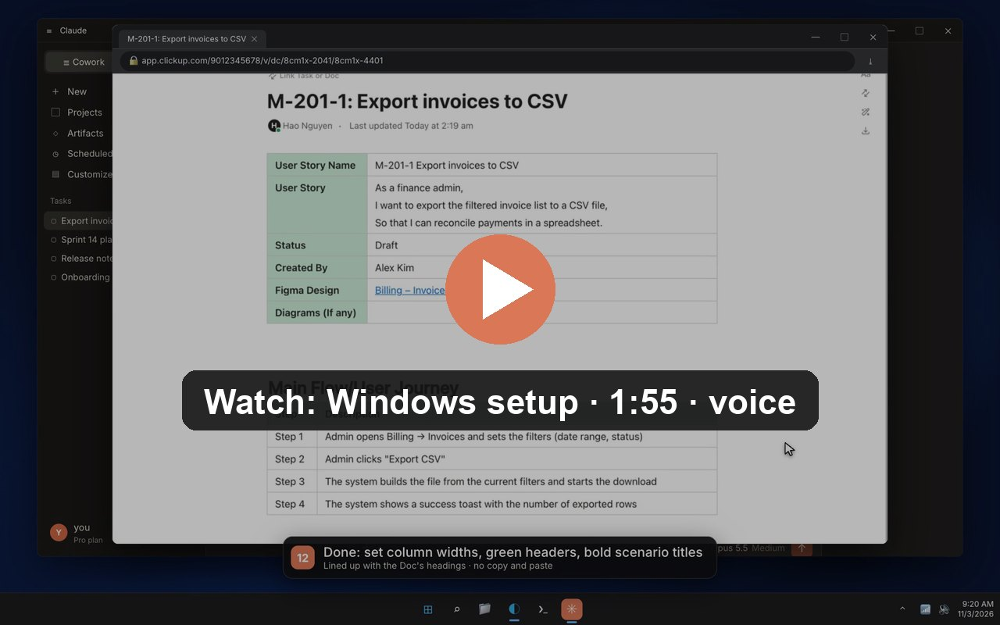

<div align="center">


# reclickup-mcp

**Every tool of the official ClickUp MCP, plus formatted tables written straight into a ClickUp Doc.**

<p>
  <a href="https://github.com/haonguyenstech/reclickup-mcp/releases/latest"></a>
  
  
  
  
  <a href="LICENSE"></a>
</p>

<a href="https://pub-ad81218f6d26484ab3b7b9f714c38911.r2.dev/videos/reclickup-mcp-windows-setup.mp4"></a>

<sub>Setup on Windows in Claude Desktop: install, sign in, add the clickup-user-story skill, write a ticket into a Doc (1:55).</sub>

</div>

An MCP server that gives you **every tool of the official ClickUp MCP** plus one thing it cannot do:
**write formatted tables into a ClickUp Doc** — set column widths, green header cells, bold text —
straight from Markdown, with nothing to copy or paste.

- Proxies the official server (`mcp.clickup.com`), so its tools stay current: read and write tasks, Docs, comments, lists.
- `clickup_doc_write` fills a Doc page from Markdown in a headless Microsoft Edge: tables fitted to the Doc's 720 px column, green header cells, bold scenario titles.
- Installs from this repo with one `uvx` line. Nothing to clone.

## Why

ClickUp's public Docs API (and the official MCP's `create/update_document_page`) only accepts Markdown
or plain text. Tables written that way always get equal-width columns and no cell colours.

The Doc editor does accept a **paste** whose `text/html` carries each table as

```html
<span class="ql-table-embed" data-table-embed-value="BASE64(JSON table-embed)"></span>
```

That is what ClickUp itself puts on the clipboard when you copy a task description. Column widths,
`cell-bg-color`, bold, links and headings all survive, and the result is saved server-side.
reclickup builds that HTML and pastes it inside its own **headless Microsoft Edge**: no window and
no clipboard.

## Tools

| Tool | What it does |
| --- | --- |
| all `clickup_*` tools of the official server | Proxied unchanged from `https://mcp.clickup.com/mcp` through [`mcp-remote`](https://www.npmjs.com/package/mcp-remote), so they stay current. |
| `clickup_doc_write` | Writes into a Doc page (`page_url`) from `markdown` (or a Quill `delta`). `mode` is `replace` (default) or `append`. If the page is untitled, it is named after the first `# ` line. Reloads the page and returns the widths, green cells and alignment of every table. Takes about 25 s. |
| `clickup_relogin` | Refreshes the ClickUp session of reclickup's headless browser. |

### Markdown it understands

`# Heading`, paragraphs, `**bold**`, `[links](url)` and pipe tables. Every table gets a bold header
row with green background cells. A table whose first header cell is `User Story Name` is a
key/value table: its first column is styled instead. Columns are sized to the Doc's 720 px text
column. Presets cover the common user-story tables (`md2delta.py` / `delta2doc.py`); any other
table is scaled proportionally.

## How it works

- **Proxy:** `reclickup_mcp/server.py` speaks MCP over stdio. It starts `npx -y mcp-remote@0.15.1 https://mcp.clickup.com/mcp`,
  forwards `tools/list` and `tools/call`, and adds its own tools. Each request runs in its own
  thread, so a slow Doc write does not block other calls.
- **Browser:** `reclickup_mcp/browser.py` runs a private headless Edge on port **9335** with its own profile
  (`~/.reclickup/headless-profile`). It starts on demand and stops after 10 minutes idle
  (`RECLICKUP_IDLE_STOP`).
- **Session:** the ClickUp session (`cu_jwt` cookie) is copied once into that profile:
  - **macOS:** from a running debug Edge on `:9222` if one is signed in, else decrypted from your
    real Edge profile. Keychain asks once for "Microsoft Edge Safe Storage": click Allow.
  - **Windows:** `clickup_relogin` opens an Edge window at the ClickUp login. Sign in once; the
    profile keeps the session.

## Install

Nothing to clone. [`uv`](https://docs.astral.sh/uv/) fetches the server straight from this repo,
installs its dependencies in a cached environment, and downloads Python itself if needed.

Requirements: **uv**, **Node.js** (for `npx`), **Microsoft Edge**.

```bash
# macOS / Linux
curl -LsSf https://astral.sh/uv/install.sh | sh
# Windows (PowerShell)
powershell -ExecutionPolicy ByPass -c "irm https://astral.sh/uv/install.ps1 | iex"
```

### Claude Desktop

Add this to `claude_desktop_config.json` (Settings → Developer → Edit Config), then restart Claude Desktop:

```json
{
  "mcpServers": {
    "reclickup-mcp": {
      "command": "uvx",
      "args": ["--from", "git+https://github.com/haonguyenstech/reclickup-mcp", "reclickup-mcp"]
    }
  }
}
```

If Claude Desktop cannot find `uvx` or `npx`, use the full path to `uvx` (`which uvx`, e.g.
`/Users/you/.local/bin/uvx`) and add `"env": { "PATH": "/opt/homebrew/bin:/usr/local/bin:/usr/bin:/bin" }`
so the path reaches `node`/`npx`.

### Claude Code

```bash
claude mcp add reclickup-mcp -- uvx --from git+https://github.com/haonguyenstech/reclickup-mcp reclickup-mcp
```

### First run

- **Official ClickUp tools:** after the restart, start a task and ask Claude something like
  *"log in to ClickUp"*. That opens a browser tab for the official ClickUp MCP: pick your workspace
  and click **Connect Workspace**. The token is cached in `~/.mcp-auth`. Until you approve, only reclickup's
  own tools are listed; the full list appears right after.
- **`clickup_doc_write`:** needs a ClickUp session in reclickup's browser. On macOS it is copied
  automatically. On Windows, call `clickup_relogin` once and sign in in the window it opens.

### Updating

`uvx` caches the build. To pick up a newer commit, run `uvx --refresh --from git+https://github.com/haonguyenstech/reclickup-mcp reclickup-mcp`
once, or pin a version in the config: `git+https://github.com/haonguyenstech/reclickup-mcp@v0.1.0`.

## Skill: clickup-user-story

[`skills/clickup-user-story/SKILL.md`](skills/clickup-user-story/SKILL.md) is a Claude skill built on
this server. It turns a BA user-story spec into a clean draft ticket and publishes it in a fixed team
style: 840 px tables with set column widths, green header cells and bold scenario titles.

- **As a task:** created through the official tools.
- **On a Doc page:** written with `clickup_doc_write`. Give it the Doc page link and the page is
  filled in directly.
- **Fix:** it also repairs existing tickets whose tables came out half width.

**Download:** [clickup-user-story.zip](https://github.com/haonguyenstech/reclickup-mcp/releases/latest/download/clickup-user-story.zip)

- **Claude Desktop / claude.ai:** Settings → Capabilities → Skills → **Upload skill**, then pick the zip.
- **Claude Code:**

  ```bash
  mkdir -p ~/.claude/skills/clickup-user-story && curl -fsSL \
    https://raw.githubusercontent.com/haonguyenstech/reclickup-mcp/master/skills/clickup-user-story/SKILL.md \
    -o ~/.claude/skills/clickup-user-story/SKILL.md
  ```

Then ask, for example: *"make a ticket from this spec into https://app.clickup.com/…/v/dc/…/…"*.
The skill reads the workspace from the link, or asks which list or Doc to use.

## Environment variables

| Variable | Default | |
| --- | --- | --- |
| `RECLICKUP_PORT` | `9335` | CDP port of the headless Edge |
| `RECLICKUP_IDLE_STOP` | `600` | Seconds of inactivity before the headless Edge is closed |
| `RECLICKUP_BROWSER` | auto | Path to the Edge executable |
| `RECLICKUP_EDGE_PROFILE` | `~/Library/Application Support/Microsoft Edge/Default` | Real Edge profile to copy the session from (macOS) |
| `RECLICKUP_CALL_BUDGET` | `50` | Seconds a call to an official tool may take before it answers `NOT_READY` (clients drop calls after ~60 s) |
| `RECLICKUP_LOGIN_WAIT` | `40` | Windows: seconds `clickup_relogin` waits for the sign-in before answering `LOGIN_PENDING` |
| `RECLICKUP_NPX` | `npx` on `PATH` | `npx` to run `mcp-remote` |
| `RECLICKUP_UPSTREAM` | `https://mcp.clickup.com/mcp` | Upstream MCP URL |

Upstream (`mcp-remote`) stderr is logged to `~/.reclickup/upstream.log`.

## Caveats

- `clickup_doc_write` relies on how ClickUp's web editor handles a paste, not on a public API.
  It can break if ClickUp changes the editor. The read-back check after each write reports
  that right away.
- Doc pages and tasks are different editors. `clickup_doc_write` only targets Doc pages
  (`/v/dc/…` or `/docs/…` links).

## License

MIT
